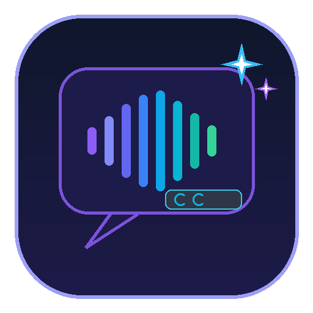
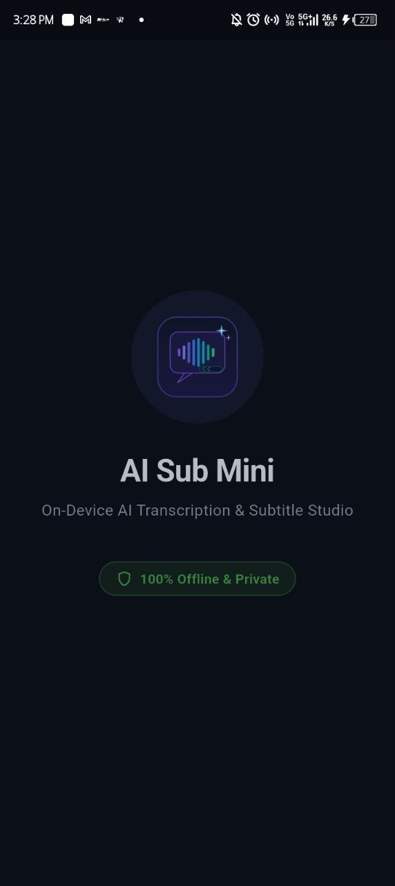
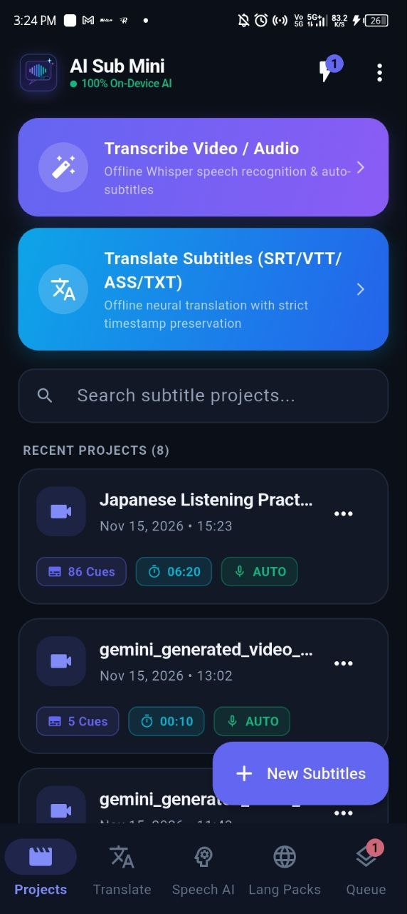
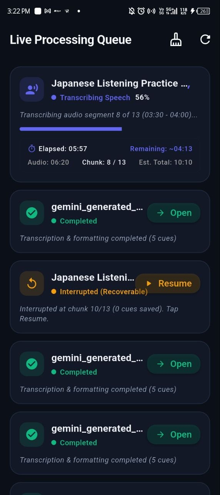
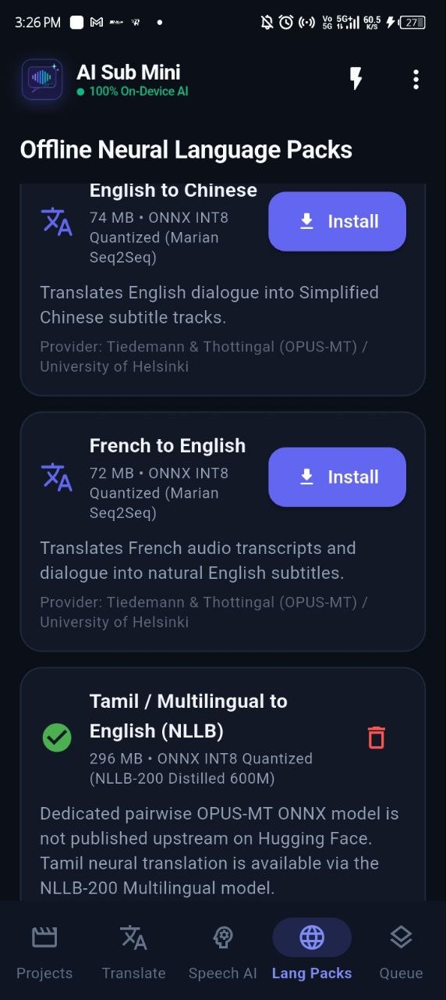
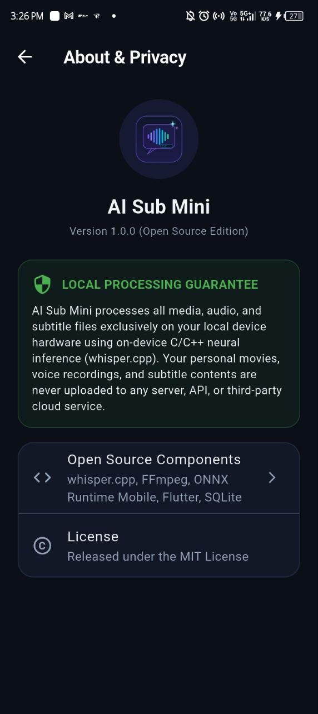

# AI Subtitle Studio

<p align="center">
  
</p>

<h3 align="center">Create. Transcribe. Translate. Edit. Export.</h3>

<p align="center">
  An offline-first AI subtitle creation and editing application powered by Whisper, ONNX Runtime, and FFmpeg.
</p>

<p align="center">
  
  
  
  
  
  
</p>

---

## 📱 Screenshots & Application Walkthrough

The following screenshots illustrate the core workflow and on-device features of **AI Subtitle Studio (AI Sub Mini)**:

| Screenshot | Screen Name & Filename | Description & Capabilities |
| :---: | :--- | :--- |
|  | **1. Splash & Privacy Launch**<br/>`screenshot/photo_5_2026-11-15_15-29-47.jpg`<br/>*(also `01_splash_screen.jpg`)* | **100% Offline & Private Startup Screen**<br/>Greets the user with the application brand and reinforces the core local processing commitment: zero cloud transcription dependencies, no telemetry, and complete data privacy. |
|  | **2. Home Dashboard & Projects**<br/>`screenshot/photo_2_2026-11-15_15-29-47.jpg`<br/>*(also `02_home_dashboard.jpg`)* | **Media Transcription & Subtitle Hub**<br/>Provides primary action cards for transcribing media or translating subtitle files (SRT, VTT, ASS, TXT). Displays recent projects with cue counts, duration indicators, quick search, and active queue notification badges. |
|  | **3. Live Processing Queue**<br/>`screenshot/photo_1_2026-11-15_15-29-47.jpg`<br/>*(also `03_live_processing_queue.jpg`)* | **Real-Time Queue with Crash Recovery**<br/>Tracks active Whisper transcription across sequential 30-second audio segments (e.g. chunk 8 of 13), elapsed and remaining ETA, completed jobs with direct project links, and an **Interrupted (Recoverable)** state with one-tap **Resume** capability. |
|  | **4. Neural Language Packs**<br/>`screenshot/photo_3_2026-11-15_15-29-47.jpg`<br/>*(also `04_neural_language_packs.jpg`)* | **Offline Translation Model Management**<br/>Install and manage INT8 quantized Marian Seq2Seq and NLLB-200 ONNX models (English to Chinese, French to English, Tamil/Multilingual to English, Japanese, Hindi) with SHA-256 verification and storage size metrics. |
|  | **5. About & Privacy Guarantee**<br/>`screenshot/photo_4_2026-11-15_15-29-47.jpg`<br/>*(also `05_about_and_privacy.jpg`)* | **On-Device Architecture & Licensing**<br/>Details the open-source native toolchain (whisper.cpp, FFmpeg, ONNX Runtime Mobile, SQLite, Flutter) and affirms that personal movies and voice recordings are processed strictly on hardware. |

---

## 📖 About

**AI Subtitle Studio** is an open-source, offline-first subtitle creation and editing application built with Flutter.

It combines local AI speech recognition, neural machine translation, video playback, subtitle editing, and multi-format export into one application.

Instead of relying on cloud transcription services, the application is designed to process media locally using downloadable AI models.

Whether you want to generate subtitles for a video, translate dialogue, correct timestamps, or customize subtitle appearance, AI Subtitle Studio aims to provide a complete workflow in one place.

### Core Philosophy

- 🔒 **Privacy-first media processing**: Your recordings stay on your device.
- 🧠 **Genuine on-device AI inference**: Whisper C++ and ONNX Runtime running on local CPU/ARM.
- 🌐 **Offline translation**: Neural models translate subtitles without network calls.
- 🎬 **Integrated video and subtitle editing**: Real-time sync, timing correction, and styling.
- 📁 **Flexible subtitle import and export**: Industry-standard SRT, VTT, and ASS support.
- ⚡ **Efficient processing for mobile devices**: Sequential on-demand chunking and safe thread limits.
- 🛠️ **Open-source and developer-friendly architecture**: Modular Riverpod state and native bindings.

> **Privacy note:** Internet access is required only to download AI speech models and translation packs. Once the required models are installed, supported inference workflows run locally without uploading media to any cloud transcription service.

---

## ✨ Features

### 1. 🎙️ AI Speech-to-Text Transcription

Powered by Whisper through a native C++ inference integration (`whisper.cpp`).

- Transcribe audio and video files offline.
- Support multilingual speech recognition with automatic language detection.
- Select from installed Whisper models directly in the pipeline.
- Download and manage speech recognition models with checksum validation.
- Generate millisecond-accurate timestamped subtitle segments.
- Process long recordings reliably using memory-efficient sequential audio segmentation.
- Monitor live processing progress, elapsed time, and dynamic ETAs in the queue.

#### Whisper Model Catalogue

| Model | Intended Use | Typical Memory Footprint |
| :--- | :--- | :--- |
| **Tiny** | Faster processing with lower resource requirements | ~390 MB RAM |
| **Base** | Balanced speed and accuracy (recommended standard) | ~500 MB RAM |
| **Small** | Improved recognition quality for varied accents | ~1.0 GB RAM |
| **Medium** | Higher accuracy with greater memory requirements | ~2.6 GB RAM |

*Actual speed and accuracy depend on the device CPU/NEON capability, audio quality, and language.*

### 2. 🌐 Offline Neural Translation

The application integrates ONNX Runtime Mobile for local neural translation running inside a dedicated background worker isolate to ensure a smooth 60 FPS user interface.

#### Configured Translation Model Families

| Language Direction | Model Family | Architecture |
| :--- | :--- | :--- |
| **Japanese → English** | OPUS-MT | Quantized Marian Seq2Seq |
| **Korean → English** | OPUS-MT | Quantized Marian Seq2Seq |
| **Hindi → English** | OPUS-MT | Quantized Marian Seq2Seq |
| **English → Hindi** | OPUS-MT | Quantized Marian Seq2Seq |
| **English → Chinese** | OPUS-MT | Quantized Marian Seq2Seq |
| **French → English** | OPUS-MT | Quantized Marian Seq2Seq |
| **Supported Multilingual → English** | NLLB-200 | NLLB-200 Distilled 600M INT8 |

#### Translation Highlights

- Downloadable modular translation packs.
- Source and target language selection.
- Subtitle cue translation with strict timestamp preservation.
- Batch translation workflow with live progress and cancel/retry support.
- Dedicated background Isolate preventing Android ANR (Application Not Responding).
- Translation error reporting with script-aware tokenization.

### 3. 🎬 Video Player & Subtitle Editor

An integrated workspace for reviewing and editing subtitles in synchronized real time.

- Import video and audio files with native media player integration.
- Preview subtitles alongside video playback with interactive scrub controls.
- View timestamped subtitle cues sorted chronologically.
- Edit subtitle dialogue directly in inline text fields.
- Add, duplicate, and delete subtitle cues.
- Split and merge subtitle cues at specific word or time boundaries.
- Adjust subtitle timing with millisecond precision.
- **Batch Time Shifting**: Shift selected or all cues forward/backward (`+/- ms`).
- **Search & Replace**: Search dialogue across the entire project and perform bulk replacements.
- Real-time subtitle cue streaming: newly transcribed chunks appear automatically as they are decoded.

### 4. 🎨 Subtitle Styling

Customize the appearance of subtitles for video display and ASS styling:

- Font size and font family selection.
- Bold and italic text formatting.
- Text fill colour.
- Background pill color and opacity.
- Outline stroke colour and width.
- Subtitle alignment (Left, Center, Right).
- Subtitle positioning (Bottom-Center, Top-Center, Bottom-Left, Bottom-Right).
- Line splitting by maximum characters per line (e.g. 42 characters) and natural punctuation boundaries.

### 5. 🛡️ Dialogue Masking

Choose how explicit dialogue should appear in exported subtitles:

| Mode | Behaviour |
| :--- | :--- |
| **Authentic Dialogue** | Preserves original dialogue without alteration |
| **Partial Masking** | Partially censors selected words (`f**k`, `b***h`) |
| **Full Masking** | Replaces selected words with asterisks (`****`) |
| **Placeholder** | Replaces selected words with a custom label (`[censored]`) |

### 6. 📤 Subtitle Import and Export

Work seamlessly with industry-standard subtitle formats:

| Format | Extension | Import | Export | Notes |
| :--- | :---: | :---: | :---: | :--- |
| **SubRip Subtitles** | `.srt` | ✅ | ✅ | Universal subtitle format |
| **WebVTT** | `.vtt` | ✅ | ✅ | HTML5 web video standard |
| **Advanced SubStation Alpha** | `.ass` | ✅ | ✅ | Full styling, fonts, colours, and positioning |

Exported subtitle files preserve dialogue, cue order, and precise timestamps. On Android, the export workflow automatically saves files to public storage (`Downloads/AI Subtitles/`) when permitted.

### 7. ⚙️ Processing Queue & Crash Recovery

Manage transcription and translation jobs through a dedicated queue:

- View queued, active, completed, and interrupted jobs.
- Monitor processing stages: `Extracting Audio`, `Transcribing`, `Translating`, `Formatting`.
- Track progress percentages, elapsed time, and dynamic remaining time.
- Inspect job error diagnostics with detailed exception traces.
- **Automatic Crash Recovery**: On app launch, interrupted jobs transition to `recoverable`, allowing users to resume transcription from the last completed chunk without duplicating cues.

---

## 🏗️ Technology Stack

| Technology | Purpose |
| :--- | :--- |
| **Flutter** | Application UI and cross-platform framework |
| **Dart** | Core application logic and background isolates |
| **whisper.cpp** | Local speech recognition C/C++ engine |
| **ONNX Runtime Mobile** | Neural machine translation inference engine |
| **FFmpeg** | Audio extraction, sample-rate conversion (16kHz mono PCM) |
| **SQLite / sqflite** | Local project, cue persistence, and job queue database |
| **Riverpod** | Reactive state management across screens |
| **GoRouter** | Declarative navigation and deep-link routing |
| **Dio** | Resumable model downloads with SHA-256 verification |
| **SharedPreferences** | User configuration and active model preferences |
| **UUID** | Unique project and cue entity identification |

### Application Architecture

```
lib/
├── app/
│   ├── app.dart                                # Root MaterialApp with Riverpod & Theme
│   ├── router.dart                             # Declarative GoRouter configuration
│   └── theme/                                  # Material 3 Dark & Light theme styling
├── core/
│   ├── errors/                                 # Typed domain failures and exceptions
│   ├── platform/                               # Device hardware and battery diagnostics
│   └── utilities/                              # SRT/VTT/ASS timestamp math and formatting
├── data/
│   ├── database/app_database.dart              # SQLite database (projects, cues, jobs)
│   └── serializers/                            # SRT, WebVTT, ASS parsers and formatters
├── domain/
│   ├── entities/                               # Project, SubtitleCue, ProcessingJob, Models
│   └── services/                               # JobScheduler, BackgroundTranslationService
├── features/
│   ├── about/                                  # About & privacy declaration screen
│   ├── batch_queue/                            # Live processing queue with recovery actions
│   ├── diagnostics/                            # System diagnostics and log viewer
│   ├── home/                                   # Home projects dashboard
│   ├── language_packs/                         # Neural translation pack manager
│   ├── media_import/                           # Media picker & job configuration
│   ├── model_library/                          # Whisper speech model manager
│   ├── settings/                               # App preferences, masking, default styling
│   ├── subtitle_editor/                        # Synchronized video player & subtitle editor
│   └── translation/                            # Standalone and batch translation screen
└── native/
    ├── media/                                  # FFmpeg audio extractor & WAV slicing utilities
    ├── translation/                            # ONNX Runtime translation & SentencePiece tokenizer
    └── whisper/                                # Whisper native FFI bindings & WhisperEngine
```

### Processing Architecture

```
MEDIA INPUT (Video / Audio)
       │
       ▼
 Media Inspection
       │
       ▼
 FFmpeg Audio Extraction (16kHz Mono 16-bit PCM WAV)
       │
       ▼
 Sequential Chunk Preparation (30s Windows)
       │
       ▼
 Whisper C++ Native Inference
       │
       ▼
 Timestamped Subtitle Cues
       │
       ▼
 Local SQLite DB (ai_subtitle_studio.db)
       │
  ┌────┴────────────────────────┐
  ▼                             ▼
Subtitle Editor         Background Neural Translation
(Video Sync & Timing)   (ONNX Runtime in Worker Isolate)
  │                             │
  └──────────────┬──────────────┘
                 ▼
       Subtitle Formatting & Masking
                 ▼
       File Export (.srt / .vtt / .ass)
```

---

## 🚀 Getting Started

### Prerequisites

Install the following development tools:
- [Flutter SDK](https://docs.flutter.dev/get-started/install) (Dart SDK `^3.12.2`)
- [Android Studio](https://developer.android.com/studio) with Android SDK (API 34/35) and NDK
- Git

### 1. Clone the repository

```bash
git clone https://github.com/margacis2/AI_Subtitle_mini.git
cd AI_Subtitle_mini
```

### 2. Install dependencies

```bash
flutter pub get
```

### 3. Check the development environment

```bash
flutter doctor -v
```

### 4. Run the application

Connect an Android device with USB debugging enabled, or launch an emulator:

```bash
flutter devices
flutter run
```

### 5. Run tests and static analysis

```bash
flutter analyze --no-fatal-infos
flutter test
```

---

## 📦 Build

### Android Debug APK
```bash
flutter build apk --debug
```

### Android Release APK (Universal)
```bash
flutter build apk --release
```

### Split APKs by Architecture (Recommended for smaller install size)
```bash
flutter build apk --release --split-per-abi
```

### Android App Bundle
```bash
flutter build appbundle --release
```

Build outputs are generated in:
- APKs: `build/app/outputs/flutter-apk/`
- App Bundle: `build/app/outputs/bundle/release/`

---

## 🧠 AI Model Management

AI models are managed modularly to keep the initial app download size lightweight.

### Whisper Speech Models
1. Open **Speech AI** / **Model Library** from the bottom navigation.
2. Select your desired Whisper model (Tiny, Base, Small, Medium).
3. Tap **Download**. The app verifies the download using SHA-256 checksums.
4. Select the installed model for media transcription.

### Translation Models
1. Open **Lang Packs** from the bottom navigation.
2. Choose your language pair (e.g., Japanese → English, French → English, Hindi → English).
3. Tap **Install** to download the ONNX encoder, decoder, and SentencePiece vocabularies.
4. Use the model immediately in the **Translate** screen or within the **Subtitle Editor**.

---

## 🔐 Privacy and Data Storage

- **Local Execution**: All media processing, speech-to-text inference, and translation occur exclusively on device hardware.
- **SQLite Database**: Subtitle projects and cues are stored locally in an unencrypted SQLite database (`ai_subtitle_studio.db`).
- **No Cloud Uploads**: The application has no tracking SDKs, no external transcription servers, and sends no user media off-device.
- **Network Usage**: Network connectivity is used exclusively for user-initiated downloads of AI models from official repositories (Hugging Face).

---

## 🛠️ Current Development Status

AI Subtitle Studio is actively maintained and continuously tested across mobile hardware:

| Component | Status | Focus |
| :--- | :---: | :--- |
| **Whisper Transcription** | Stable | Sequential chunking, multi-threaded mobile CPU execution |
| **Model Management** | Stable | Direct Hugging Face downloads with SHA-256 verification |
| **Neural Translation** | Stable | Dedicated background isolate, INT8 ONNX models, no UI ANR |
| **Subtitle Editor** | Stable | Synchronized playback, live streaming cues, in-editor translation |
| **Queue & Recovery** | Stable | Persistent state machine, crash recovery, resume without duplication |
| **Public Storage Export** | Stable | Android MediaStore & public Downloads export |

---

## 🐛 Reporting Bugs

Found a bug or unexpected behaviour?
[Open a GitHub Issue](https://github.com/margacis2/AI_Subtitle_mini/issues)

When reporting a problem, please include:
- Device model and Android version
- Application version or commit hash
- Selected Whisper or translation model
- Audio/video duration and format
- Steps to reproduce and relevant Logcat output

---

## 🤝 Contributing

Contributions, bug reports, and pull requests are warmly welcomed:
1. Fork the repository.
2. Create a feature branch (`git checkout -b feature/improvement`).
3. Make your changes and run `flutter analyze` and `flutter test`.
4. Submit a pull request with a descriptive summary of your changes.

---

## 📄 License

This project is open-source software released under the **MIT License**.  
Third-party libraries (whisper.cpp, FFmpeg, ONNX Runtime Mobile) and AI model weights retain their respective open-source licenses and terms of use.

---

## 👨‍💻 Project

**AI Subtitle Studio — Open Source**  
Repository: [https://github.com/margacis2/AI_Subtitle_mini](https://github.com/margacis2/AI_Subtitle_mini)  
*Built with Flutter, Whisper, ONNX Runtime, and FFmpeg.*

<p align="center">
  <b>Making subtitle creation more accessible with local, private AI.</b>
</p>
